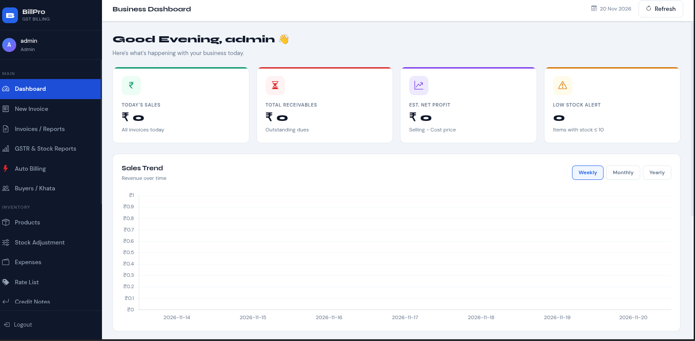
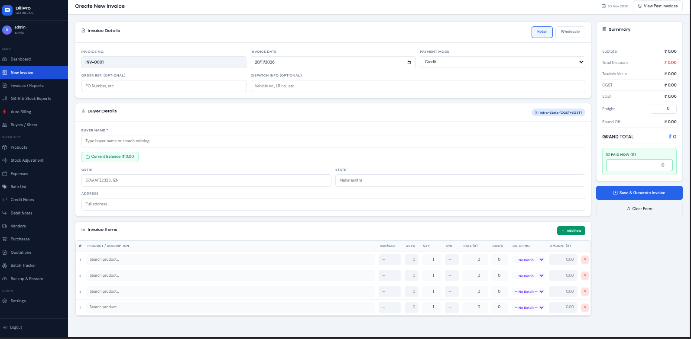
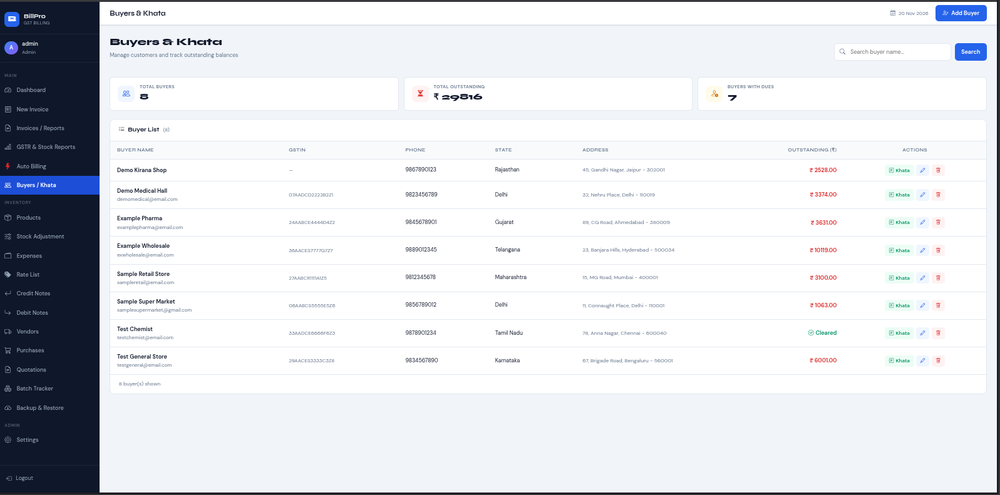
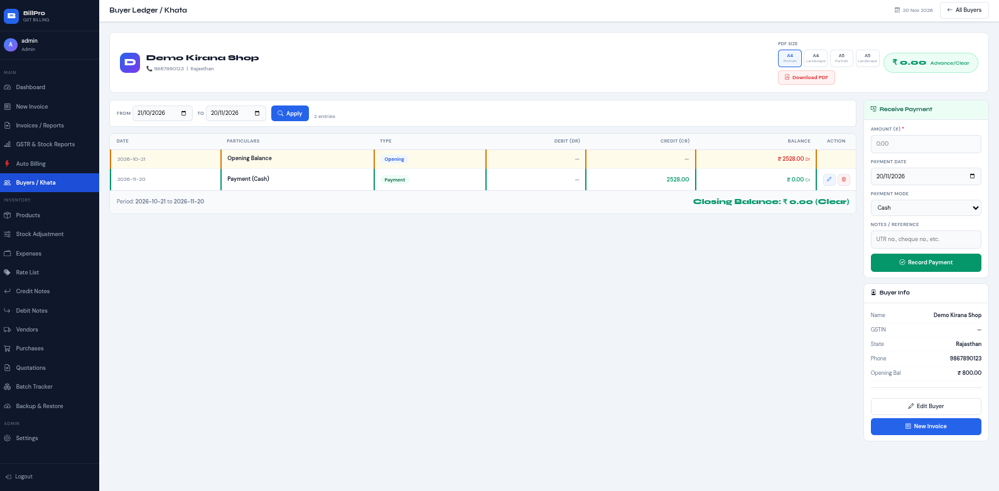
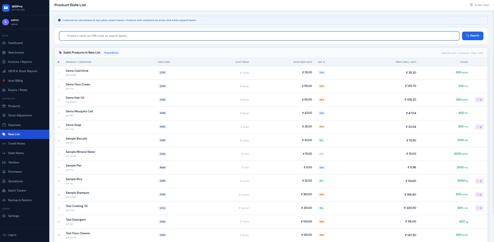
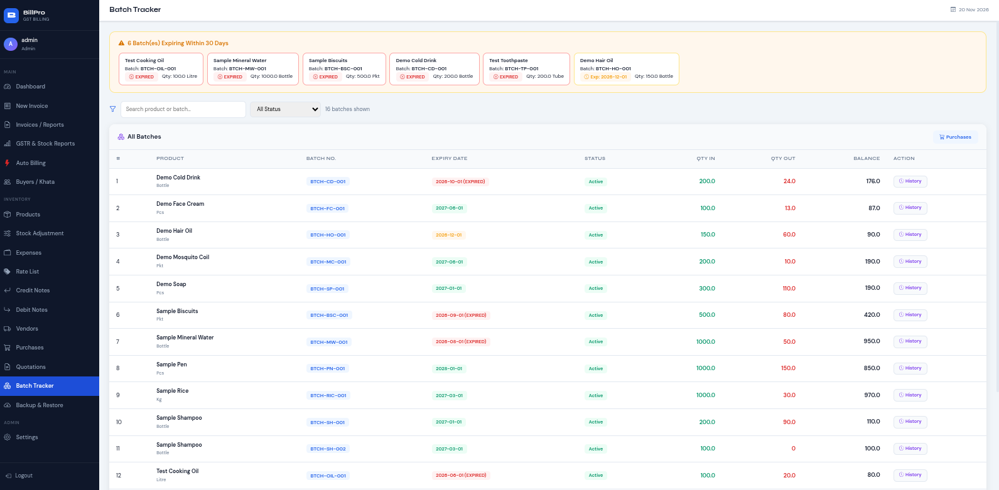

::: {align="center"}
``{=html}

# BillPro

### Professional GST Billing & Inventory Management

A local-first business management system for billing, inventory,
purchases, customer accounts, and GST reporting.

[](https://www.python.org/)
[](https://flask.palletsprojects.com/)
[](https://www.sqlite.org/)
[](LICENSE)
[](#-installation)

[Features](#-features) · [Screenshots](#-screenshots) ·
[Installation](#-installation) · [Technology](#-technology-stack)
:::

------------------------------------------------------------------------

## 📌 Overview

**BillPro** is a Python Flask-based billing and inventory management
application for day-to-day business operations. It brings GST invoice
creation, product and stock management, purchase records, buyer/vendor
ledgers, batch and expiry tracking, and business reports into one
browser-based interface.

BillPro runs locally using **Flask and SQLite**. It can be used from a
desktop browser or an Android device through Termux.

> **Local-first:** Business records are stored in a local SQLite
> database. Internet access is needed during installation and for
> externally hosted interface assets such as Chart.js and Bootstrap
> Icons.

## ✨ Features

  -----------------------------------------------------------------------
  Area                                Capabilities
  ----------------------------------- -----------------------------------
  🧾 Billing                          GST invoices, retail/wholesale
                                      billing, partial payments and
                                      multiple payment modes

  🧮 GST                              CGST/SGST or IGST presentation
                                      based on seller and buyer state

  📦 Products                         HSN, GST rate, purchase cost,
                                      retail/wholesale price, units and
                                      stock

  🎨 Variations                       Variation-specific cost, selling
                                      price, wholesale price and stock

  🏷️ Rate List                        Searchable product/variation list
                                      with HSN, GST, cost and stock

  📊 Inventory                        Automatic stock deduction, stock
                                      adjustment history and reorder
                                      alerts

  🧾 Purchases                        Supplier bills, resale/raw-material
                                      purchase types and partial payments

  📦 Batch Tracking                   Batch number, expiry date,
                                      inward/outward movement and expiry
                                      alerts

  👥 Buyers & Khata                   Customer profiles, opening
                                      balances, credit limits, payment
                                      entries and running ledger

  🏭 Vendors                          Supplier profiles, payable balances
                                      and vendor ledger

  🔄 Credit/Debit Notes               Sales returns, purchase returns and
                                      linked ledger/stock adjustments

  📋 Quotations                       Create quotations and convert
                                      approved quotations into tax
                                      invoices

  📈 Reports                          GSTR-1, GSTR-2B/purchase register,
                                      GSTR-3B, stock and outstanding
                                      reports

  📄 PDF & Excel                      Export supported invoices and
                                      reports

  💸 Expenses                         Category-based expense register
                                      with date filters and totals

  📲 Sharing                          WhatsApp message pre-filled with
                                      invoice details; attach the PDF
                                      manually

  🗄️ Backup                           Download and restore validated
                                      database backups

  👤 User Roles                       Admin and Cashier access levels

  📱 Mobile UI                        Dedicated mobile layout for phones
                                      and tablets

  📝 Logs                             Rotating activity and error logs
  -----------------------------------------------------------------------

## 🖥️ Screenshots

### Business Dashboard

Monitor today's sales, receivables, estimated profit, low-stock alerts,
and sales trends.



### Create Invoice

Prepare retail or wholesale invoices, select buyers and products, choose
batches, and review GST and invoice totals.



### Buyers & Khata

Manage customer records and identify outstanding balances.



### Buyer Ledger

Review opening balance, debit/credit entries, payments, and closing
balance. Record payments and download the ledger PDF.



### Product Rate List

Search by product name or HSN and review cost, selling rate, GST,
inclusive price, and stock.



### Batch Tracker

Track batch numbers, expiry dates, quantities in/out, remaining stock,
and batch history.



## 🚀 Installation

### Windows

1.  Download `install.bat` from this repository.
2.  Double-click `install.bat`.
3.  The installer checks Python, downloads the project, creates a
    virtual environment, installs dependencies, and creates a
    `start.bat` launcher.
4.  After installation, double-click `start.bat`.

Open:

``` text
http://localhost:5000
```

### Linux / macOS

``` bash
bash <(curl -fsSL https://raw.githubusercontent.com/djkalirdp/billpro-official/main/install.sh)
bash start.sh
```

Then visit `http://localhost:5000`.

### Android (Termux)

Install Termux, then run:

``` bash
curl -fsSL https://raw.githubusercontent.com/djkalirdp/billpro-official/main/install.sh -o install.sh
bash install.sh
bash start.sh
```

Open the phone browser at:

``` text
http://localhost:5000
```

Keep the Termux session running while using BillPro. To access the app
from another device on the same Wi-Fi network, use the phone's local IP
and port `5000`:

``` text
http://PHONE-IP:5000
```

### Manual Installation

Requirements: Python 3.8 or newer and a modern browser.

``` bash
git clone https://github.com/djkalirdp/billpro-official.git
cd billing

python3 -m venv venv

# Linux / macOS
source venv/bin/activate

# Windows PowerShell:
# .\venv\Scripts\Activate.ps1

pip install -r requirements.txt
python app.py
```

Open `http://localhost:5000`.

> On Windows, use the provided `install.bat` for guided installation. On
> Android, use the Termux installer.

## 🔐 First Login

The repository documents these default credentials:

  Field      Default
  ---------- ------------
  Username   `admin`
  Password   `admin123`

**Security:** Change the default password immediately after the first
login through **Settings → Users → Change Password**. Do not expose an
installation with default credentials to an untrusted network.

### User Roles

  -----------------------------------------------------------------------
  Role                                Access
  ----------------------------------- -----------------------------------
  Admin                               Full access to billing, inventory,
                                      reports, settings and user
                                      management

  Cashier                             Billing, buyers and invoice viewing
  -----------------------------------------------------------------------

## 🧾 Main Workflows

### Create a GST Invoice

1.  Open **New Invoice**.
2.  Select an existing buyer or enter buyer details.
3.  Add products and variations.
4.  Select a batch when required.
5.  Review item discounts, GST, freight and round-off.
6.  Choose the payment mode and enter the amount received.
7.  Save and generate the invoice.

The documented workflow automatically deducts stock after a saved sale.
Same-state transactions use CGST + SGST, while different-state
transactions use IGST.

### Manage Customer Accounts

-   Maintain buyer details such as GSTIN, state, phone and address.
-   Set opening balances and optional credit limits.
-   Open **Buyers / Khata** to view customer balances.
-   Record, edit or delete payment entries.
-   Review date-wise ledger entries and closing balance.

### Manage Purchases & Vendors

-   Maintain vendor profiles.
-   Record purchase bills and GST details.
-   Choose **Resale** when goods should increase stock.
-   Choose **Raw Material** when the purchase should not change resale
    stock.
-   Track partial payments in the vendor ledger.

### Track Product Batches

-   Enter batch number and expiry details in purchase records.
-   Select a batch during billing when applicable.
-   Review inward and outward quantities.
-   Check batch history and expiry alerts.

### Generate Reports

-   **GSTR-1:** outward supplies
-   **GSTR-2B / Purchase Register:** inward supplies
-   **GSTR-3B:** output tax, ITC and net payable summary
-   **Stock Report**
-   **Customer Outstanding**
-   **Vendor Outstanding**

Supported reports provide PDF and/or Excel export as documented by the
application.

## 🧰 Technology Stack

  Component          Technology
  ------------------ ----------------------------
  Language           Python 3.8+
  Web framework      Flask 2.3+
  Database           SQLite
  Templates          Jinja2
  UI framework       Bootstrap 5
  Charts             Chart.js 4.4.1
  Icons              Bootstrap Icons
  PDF generation     ReportLab 4.0+
  Excel export       openpyxl 3.1+
  Amount in words    num2words (`en_IN`)
  QR codes           qrcode + Pillow
  Password hashing   Werkzeug PBKDF2
  Logging            Python RotatingFileHandler

## 📁 Project Structure

``` text
billing/
├── app.py
├── database_manager.py
├── pdf_generator.py
├── pdf_generator_v2.py
├── reports_generator.py
├── create_sample_db.py
├── requirements.txt
├── install.bat
├── install.sh
├── logo.png
├── logo_dark.png
├── logo_icon.png
├── sample_billing.db
├── LICENSE
├── DEVELOPER_GUIDE.md
├── data/
├── static/
│   └── uploads/
├── templates/
└── tests/
```

Runtime-created files and folders may include the SQLite database,
settings, generated invoices/reports, and application logs.

## 🗃️ Sample Database

The repository includes `sample_billing.db` with demo records for trying
the application.

Use demo data only for testing. Before replacing an existing database,
make a separate backup of your current business data. Follow the
developer guide and backup/restore workflow for database handling.

## 🧪 Running Tests

Run the project's unittest suite from the repository root:

``` bash
python -m unittest discover -s tests -v
```

## ⚠️ Important Notes

-   Change the default admin password immediately.
-   Configure the business state before creating invoices; it affects
    CGST/SGST versus IGST treatment.
-   Verify product and variation costs if you rely on estimated profit
    figures.
-   Keep regular backups outside the device running BillPro.
-   Restoring a backup replaces the active database. Verify the backup
    before restoring.
-   WhatsApp sharing opens a pre-filled message; download and attach the
    invoice PDF manually.
-   Chart.js and Bootstrap Icons are loaded from a CDN, so those
    interface assets require internet access.
-   Verify GST reports and calculations with a qualified professional
    before statutory filing. BillPro is a business-management tool, not
    a substitute for professional tax advice.

## 🛣️ Roadmap

The repository documents these planned areas:

  -----------------------------------------------------------------------
  Version                             Planned focus
  ----------------------------------- -----------------------------------
  V1.5                                Barcode, multi-location inventory,
                                      overdue interest and audit trail

  V2.0                                Manufacturing: BOM, production, WIP
                                      and cost sheet

  V2.5                                Google Drive cloud sync

  V3.0                                E-Invoice (IRN), E-Way Bill and
                                      bank reconciliation
  -----------------------------------------------------------------------

Roadmap items are plans, not claims that those features are already
available.

## 🤝 Contributing

Suggestions, bug reports and pull requests are welcome.

1.  Fork the repository.
2.  Create a feature branch.
3.  Make focused changes.
4.  Run the test suite.
5.  Submit a pull request describing the change and how it was tested.

For bug reports, include reproduction steps, expected behaviour, actual
behaviour, and relevant logs or screenshots. Remove customer
information, passwords, GSTINs and other sensitive business data before
sharing.

## 📄 License

This project is distributed under the **MIT License**. See
[`LICENSE`](LICENSE) for the full license text.

------------------------------------------------------------------------

::: {align="center"}
**BillPro** --- Billing, Inventory & Business Management

Made for practical day-to-day business workflows.
:::
